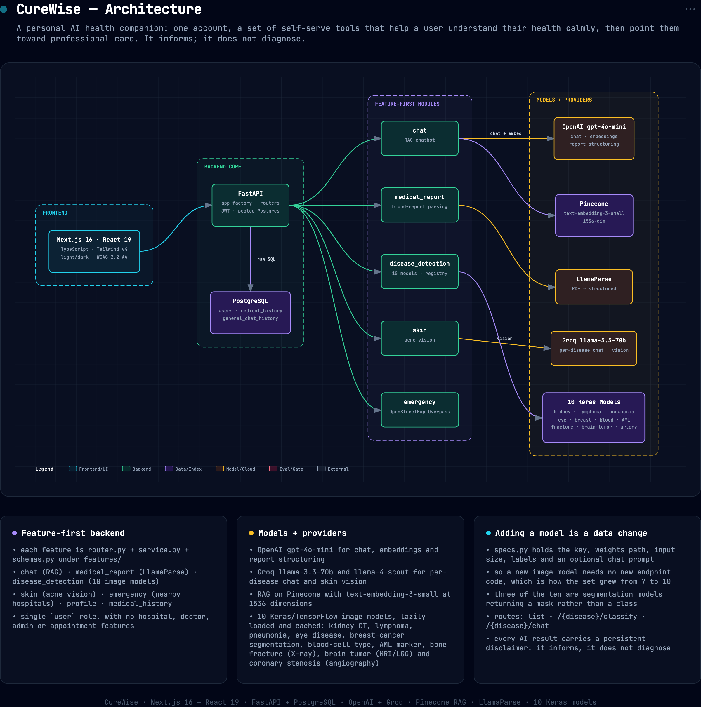

# CureWise

CureWise is a personal AI health companion. One account gives a user a set of
self-serve tools that help them understand their health calmly, then point them
toward professional care. It informs; it does not diagnose.

There are no hospital, doctor, admin, or appointment features. Every account is a
single `user` role.

---


## Architecture



*Interactive/exportable version: [`docs/assets/architecture.html`](docs/assets/architecture.html).*

## What it does

- **Health assistant** — a chatbot grounded in a curated medical knowledge base
  (RAG over Pinecone), with plain-language answers.
- **Blood report reader** — upload a lab PDF, get it parsed (LlamaParse) and
  explained in plain words, with a structured results table.
- **Image screening** — screen a medical image across ten trained models:
  kidney (CT), lymphoma, pneumonia, eye disease, blood-cell type, AML genetic
  markers and bone fracture (X-ray) as classifiers; breast-cancer imaging,
  brain tumour (MRI, LGG) and coronary stenosis (angiography) as segmentation.
- **Skin & acne check** — a first read on a skin photo using a vision model.
- **Per-condition chat** — a specialist assistant for each disease area.
- **Nearby care** — find hospitals near the user's location (OpenStreetMap
  Overpass), for emergencies.

Every AI result carries a persistent disclaimer: CureWise informs, and does not
diagnose.

---

## Tech stack

**Backend** — FastAPI, PostgreSQL (raw SQL over a pooled connection), JWT auth
(python-jose + passlib/bcrypt). LLMs: OpenAI `gpt-4o-mini` (chat, embeddings,
report structuring), Groq `llama-3.3-70b` / `llama-4-scout` (per-disease chat,
skin vision). RAG on Pinecone (`text-embedding-3-small`, 1536-dim). Blood-report
parsing via LlamaParse. Image models are Keras/TensorFlow `.h5` files loaded
lazily and cached.

**Frontend** — Next.js 16 (App Router), React 19, TypeScript, Tailwind v4. Light
and dark themes, calm clinical design, WCAG 2.2 AA. See `DESIGN.md` and
`PRODUCT.md`.

---

## Backend architecture

Feature-first layout under `backend/src`:

```
backend/src/
  main.py                 # app factory, router mounting, lifespan
  core/                   # config, db pool, security (JWT), deps, logging,
                          #   uploads (size/type caps), ratelimit
  db/schema.py            # users, medical_history, general_chat_history,
                          #   medical_report_context
  auth/                   # signup / login / me
  features/
    profile/              # each feature: router.py, service.py, schemas.py
    medical_history/
    chat/                 #   RAG chatbot (rag.py)
    medical_report/       #   LlamaParse + structuring (parser.py)
    skin/                 #   acne vision
    emergency/            #   nearby hospitals
    disease_detection/    #   registry of 10 models (specs.py, registry.py)
```

`backend/scripts/ingest_rag.py` seeds the Pinecone knowledge base the chat
assistant retrieves from.

Adding a new image model is a data change in
`features/disease_detection/specs.py` (key, weights path, input size, labels,
optional chat prompt), not new endpoint code. The routes are:

```
GET  /api/disease-detection                      # list models
POST /api/disease-detection/{disease}/classify   # image -> prediction
POST /api/disease-detection/{disease}/chat        # specialist Q&A
```

Trained model weights live under `backend/weights/<key>/` (kept separate from
`backend/data/`, which holds only datasets and sample test images). Weights are
large (~1.5 GB) and gitignored; provision them out of band or regenerate the
trainable ones with `backend/ml_training/`.

---

## Setup

### Backend

```bash
cd backend
cp .env.example .env          # fill in API keys + DB settings
python -m venv .venv && source .venv/bin/activate
pip install -r requirements.txt
uvicorn src.main:app --reload --port 8000
```

Requires a running PostgreSQL. The schema is created automatically on startup.

#### Seed the knowledge base

The chat assistant retrieves from a Pinecone index. The app creates that index
if it's missing, but an **empty** index means retrieval returns nothing and
every answer degrades to "that isn't in my knowledge base". Seed it once:

```bash
python scripts/ingest_rag.py --dry-run     # chunk + count, no API calls
python scripts/ingest_rag.py               # ~17k chunks from data/rag/data.csv
```

Roughly 5.6M embedding tokens on the full corpus (about $0.11 on
`text-embedding-3-small` at time of writing). Vector ids are deterministic, so
re-running updates in place instead of duplicating. `--limit N` ingests a
subset; `--recreate` drops the index first.

#### Check it works

```bash
python tests/smoke_test.py   # drives the live API; no provider keys needed
```

#### Model weights

The ten screening models need their `.h5` weights in `backend/weights/<key>/`.
They aren't in the repo (~1.5 GB, gitignored) — without them the screening
routes return 503 and every other feature still works. Provision them out of
band, or regenerate the trainable ones with `backend/ml_training/`.

### Frontend

```bash
cd frontend
cp .env.example .env.local    # NEXT_PUBLIC_API_URL, defaults to localhost:8000
npm install
npm run dev                   # http://localhost:3000
```

### Docker

```bash
docker compose up --build     # postgres + backend (8000) + frontend (3000)
```

`./backend/weights` and `./backend/data` are mounted into the backend
container, so the image stays small. Requires `backend/.env` to exist.

---

## Directory structure

```
CureWise-AI-Medical-Healthcare/
├── backend/          # FastAPI app (src/), scripts/ (RAG ingest),
│                  #   weights/ (models), data/ (datasets+samples), ml_training/
├── frontend/         # Next.js 16 app
├── docker-compose.yml
├── PRODUCT.md        # strategic product brief
├── DESIGN.md         # visual system (tokens, type, components)
└── README.md
```

---

## License

See repository license.
